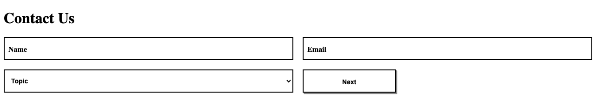
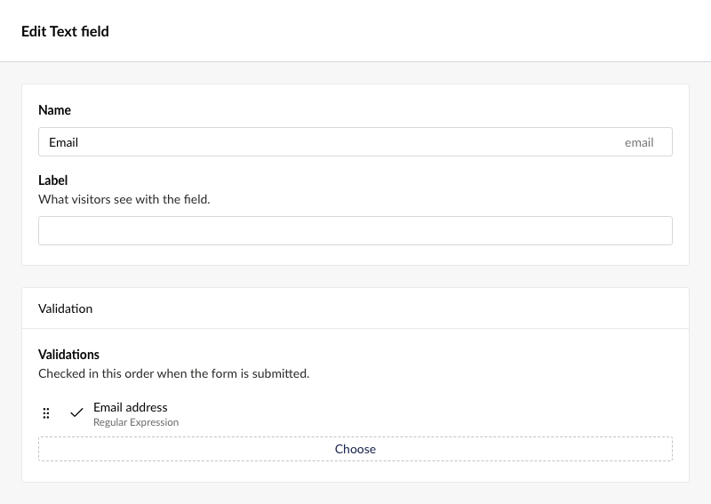
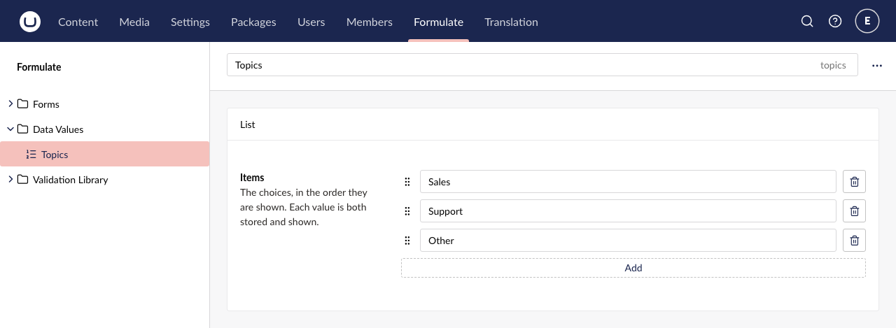
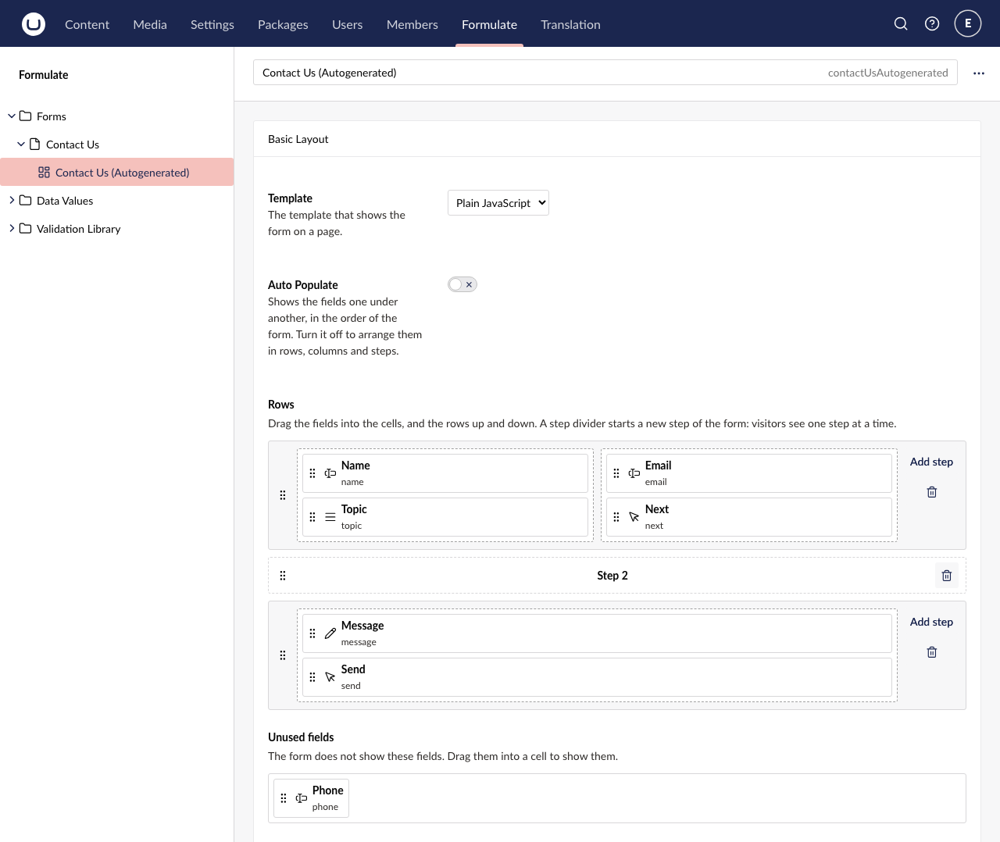
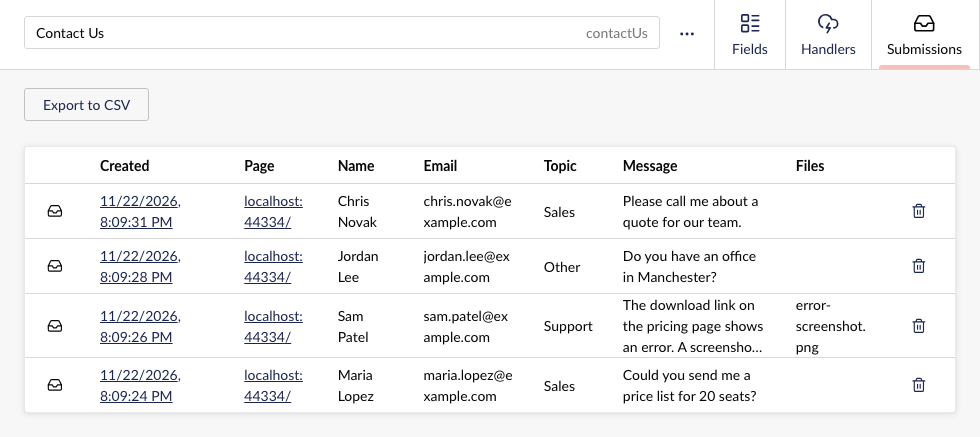

# Creating a Complex Form

This tutorial builds on the Contact Us form from [Creating a Simple Form](/simple-form). It makes the form a two step form, with validations, a drop down and a layout in rows and columns, and then reads what visitors sent.

The steps are:

* Create a simple form.
* Add more fields and two buttons.
* Add validations and pick them on fields.
* Make a list of data values for a drop down.
* Arrange the layout in rows, cells and steps.
* Store the submissions and read them.

# Start with a Simple Form

Follow [these instructions](/simple-form) to make the Contact Us form, with a layout and a page that shows it.

# Add More Fields and Two Buttons

On the form's Fields tab, choose Add field for each of these, and fill in the dialog:

* A Text field named Phone.
* A Drop Down field named Topic (you set its list of choices below).
* A Button field named Next, with its Button kind set to Next. It moves to the next step and does not send the form.
* Keep the Send button, with its Button kind set to Submit.

The Button kind select lists Next, Previous and Submit. Formulate treats any other kind as a Submit button.

# Add Validations

Validations are made once in the Validation Library, then picked on fields. The two kinds that ship are Mandatory and Regular Expression. See [Validations](/validations) for their settings.

1. Under Validation Library, create a Mandatory validation with the message "Please enter a message.".
2. Create a Regular Expression validation for email addresses with the message "Please enter a valid email address.".
3. Open the Email field, find its Validations setting, choose Choose and pick the Regular Expression validation. Pick the Mandatory validation on the Message field.
4. Choose Submit to close each dialog, then Save the form.

# Make a List of Data Values

A drop down gets its choices from a list of data values.

1. Under Data Values, open the menu of the root and choose Create, then pick List. A Pair List is the same, but each choice has a value and a label.
2. Name it "Topics" and add the choices, such as Sales, Support and Other.
3. Choose Save.
4. Open the Topic field on the form. In its Data Values setting, choose Choose and pick the Topics list.
5. Choose Submit, then Save the form.

# Arrange the Layout

A form with Form with Basic Layout has a layout that shows every field, one under another, because Auto Populate is on. To arrange the fields yourself:

1. Open the layout in the tree. It is under the form.
2. Turn off Auto Populate. A form with Auto Populate off shows only the fields you put in cells.
3. Under Rows, choose Add row. Click a column to start a new cell at it, or click it again to join it to the cell before it. A row is 12 columns wide. For two cells of 6 columns, click column 7 (Start a cell at column 7), then choose Add row.
4. Drag the fields into the cells, and the rows up and down. Fields not in a cell are listed under Unused fields. The form does not show them.
5. Choose Add step after a row to add a step divider. A step divider starts a new step of the form, and visitors see one step at a time. It needs a row before it and a row after it.
6. Put the Next button at the end of the first step and the Send button at the end of the last, then choose Save.

# Store the Submissions

1. Open the form's Handlers tab, choose Add handler and pick Store Data. It has nothing to set.
2. Choose Save.

Each submission is now stored in the Umbraco database: the values of its fields, the page it was sent from and the files sent with it.

# Read the Submissions

Open the form and choose its Submissions view. It lists each submission, newest first, with the date it was sent (Created), the Page, the values of some of the fields and any Files.

* **Open.** Click a row, or its date, to see the whole submission, with each file as a download button.
* **Download.** In the open submission, choose a file's button to download it.
* **Export to CSV.** Choose Export to CSV to download every submission of the form.
* **Delete.** Choose the delete button on a row, then confirm. Its files are deleted with it.

The Submissions view is for a form with a Store Data handler. Without one, it says there are no submissions yet.

