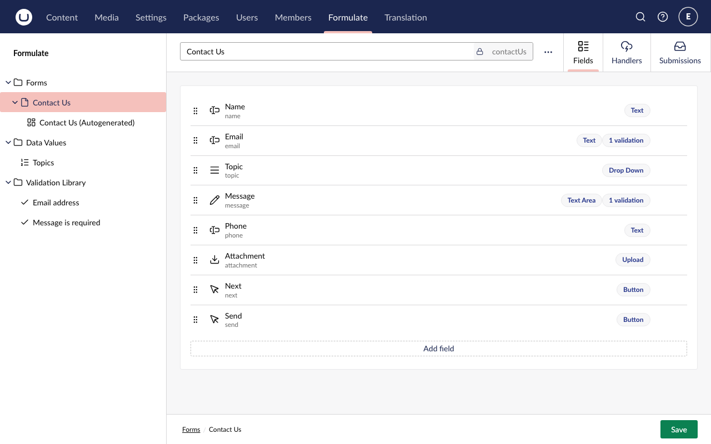

    <h2>Formulate 5 is here</h2>
    
Formulate 5 runs on Umbraco 17.6 or later 17.x, Umbraco 18 and the Umbraco 19 release candidate. Formulate Pro is now part of Formulate, for free. See <a href="/whats-new-in-5" title="What's new in Formulate 5">what's new in Formulate 5</a>.

# Formulate

Formulate is a free, open source form builder for Umbraco.

Here are a few pages that will help you get started with Formulate:

* [What's New in Formulate 5](/whats-new-in-5)
* [What is Formulate?](/what-is-formulate)
* [Requirements](/requirements)
* [Installing](/installing)
* Create Forms:
  * [Simple Form](/simple-form)
  * [Complex Form](/complex-form)
* [Render Form](/plain-javascript/render-form)
* Additional Tips:
  * [Validations](/validations)
  * [Designed Emails](/pro/designed-emails)
  * [Basic Theme](/pro/basic-theme)
  * [SMTP Configuration](/smtp-configuration)
* Advanced Topics:
  * [Extensibility](/extensibility)
  * [Contributing to Formulate](https://github.com/Nicholas-Westby/formulate#contributing)
  * [Custom Field Types](/articles/custom-field-types)
* [Frequently Asked Questions](/faq)
* [Testimonials](/testimonials)

If you have a question or find a problem, please [open an issue on GitHub](https://github.com/Nicholas-Westby/formulate/issues). You can also [contact me](https://www.nicholaswestby.com/contact/) directly.

Using Formulate 3 with Umbraco 8? The pages above that mention Formulate 3 still apply to you. The old tutorials and the [forum](https://our.umbraco.com/packages/backoffice-extensions/formulate/formulate-questions/) are still there.
