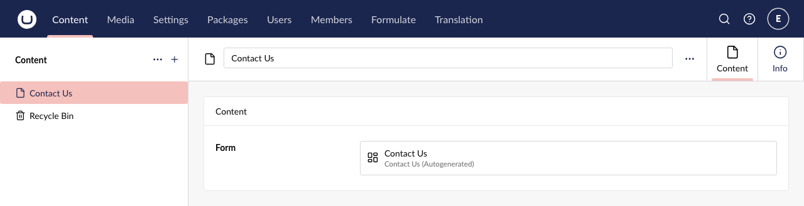

# Rendering a Form in Formulate 5

Formulate 5 renders forms with plain JavaScript. There is no AngularJS template.

Once you've installed Formulate and created a form, there are five steps to show it on a page.

1. Create a data type that uses the "Formulate Form Layout Picker" property editor (alias `Formulate.FormLayoutPicker`).
2. Add a property that uses this data type (for example, with the alias `form`) to a document type.
3. On a content node, pick a form layout.
4. Render it in your Razor template:

   ```cshtml
   @await Component.InvokeAsync("FormulateForm", Model.Value<Formulate.Core.FormLayout>("form"))
   ```

   If you use Models Builder, this works too:

   ```cshtml
   @await Component.InvokeAsync("FormulateForm", Model.Form)
   ```

   The component shows nothing, and writes nothing to the log, when no form is picked, when the picked layout was deleted or does not belong to a form, or when the form was deleted or has no fields. When the layout has no template, or its template isn't installed, it shows nothing and logs a warning.

5. The form renderer is added to the page automatically, once per page, even when the page has several forms. It is a set of small JavaScript modules: the page preloads them and loads `formulate.min.js` with `<script type="module">`. To add it yourself instead, turn this off in `appsettings.json`:

   ```json
   {
     "Formulate": {
       "PlainJavaScript": {
         "IncludeScript": false
       }
     }
   }
   ```

   Then see [Loading the Renderer Yourself](/plain-javascript/custom-field-renderers#loading-the-renderer-yourself).

Forms have no styles unless you turn on the [basic theme](/pro/basic-theme), with `"Theme": "basic"` under `Formulate:PlainJavaScript` in `appsettings.json`. The settings are listed in the [README on GitHub](https://github.com/Nicholas-Westby/formulate/blob/v5/main/README.md#settings).



The front-end classes (BEM names such as `formulate__...`), the JavaScript events and the custom field type hooks (`window["formulate-plain-js-fields"]`) are the same as in Formulate 3. Existing styles and custom field types keep working.

To add a field type of your own, or to change how a built-in field renders, see [Custom Field Renderers](/plain-javascript/custom-field-renderers). A renderer can build on a built-in one, so a phone field takes a few lines.

# Handling Events

You can respond to the events that Formulate dispatches, such as a successful submission or validation errors. Formulate dispatches them on the `.formulate-wrapper` element. The form view writes that element around each form, so you don't add one yourself. Just render the form and add your script:

```html
@await Component.InvokeAsync("FormulateForm", Model.Form)

<script src="/scripts/custom-formulate-script.js" defer></script>
```

Here is `custom-formulate-script.js`:

```js
/* This file listens for events dispatched by Formulate and responds to them appropriately. */

// Wait until the page has been parsed, so the wrapper elements exist.
document.addEventListener("DOMContentLoaded", function () {

    // Variables.
    let i, wrapper, wrappers = document.querySelectorAll(".formulate-wrapper");

    // Process each wrapper element that Formulate writes around a form.
    for (i = 0; i < wrappers.length; i++) {
        wrapper = wrappers[i];
        (function (wrapper) {

            // Variables.
            let validationListElement;

            // On form submit, remove the form and display a success message. You can do what you like here
            // (e.g., show a hidden element).
            wrapper.addEventListener("formulate form: submit: success", function (e) {
                let form = e.target;
                form.parentNode.replaceChild(document.createTextNode("Form submitted!"), form);
                if (validationListElement) {
                    validationListElement.parentNode.removeChild(validationListElement);
                }
                validationListElement = null;
            });

            // When proceeding to the next step in a multi-step form, clear any validation errors.
            wrapper.addEventListener("formulate: validation: next: success", function () {
                if (validationListElement) {
                    validationListElement.parentNode.removeChild(validationListElement);
                }
                validationListElement = null;
            });

            // When there is an error, show an alert dialog. Feel free to change this to something
            // that makes more sense for your project.
            wrapper.addEventListener("formulate form: submit: failure", function () {
                alert("Unknown error. Please try again.");
            });

            // When there are validation errors, add a list of error messages to the bottom of the
            // form. If you remove this, the error messages will still be shown inline below each field.
            wrapper.addEventListener("formulate: submit: validation errors", function (e) {
                let i, message, messages = e.detail.messages, form = e.target, listElement, itemElement;
                listElement = document.createElement("ul");
                listElement.classList.add("formulate__validation-summary");
                for (i = 0; i < messages.length; i++) {
                    message = messages[i];
                    itemElement = document.createElement("li");
                    itemElement.classList.add("formulate__validation-summary__error");
                    itemElement.appendChild(document.createTextNode(message));
                    listElement.appendChild(itemElement);
                }
                if (validationListElement) {
                    validationListElement.parentNode.replaceChild(listElement, validationListElement);
                }
                validationListElement = listElement;
                form.parentNode.appendChild(listElement);
            });

        })(wrapper);
    }

});
```

Next up, you'll want to style the form: [Styles](/plain-javascript/styles), or turn on the optional [basic theme](/pro/basic-theme).

# Formulate 3

The Formulate 3 version of this page used `@Html.Action("Render", "FormulateRendering", ...)` and a script tag for `/App_Plugins/formulate/responsive.plain-javascript.min.js`. For Umbraco 7, see [github.com/.../plain-javascript/render-form.md](https://github.com/Nicholas-Westby/formulate/blob/a0b705a71a6a9034e1041d7c8d08ee4a748a6359/plain-javascript/render-form.md). The AngularJS page, [Render AngularJS Form](/angularjs/render-form), applies to Formulate 3 only.
