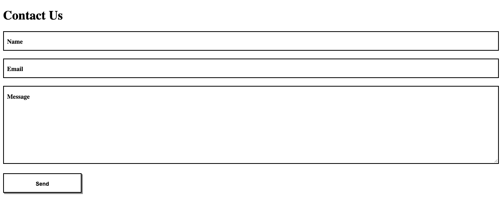

# Basic Theme

The basic theme used to be part of Formulate Pro. Formulate Pro is now part of Formulate, so the theme is in the main package, for free.

It's optional CSS that styles your forms, so you don't have to.

By default, Formulate forms have no styles:


With the basic theme, they look like this:



# Turning It On

Add this to `appsettings.json`:

```json
{
  "Formulate": {
    "PlainJavaScript": {
      "Theme": "basic"
    }
  }
}
```

Restart your website. Forms now have the basic theme.

If you'd rather write your own CSS, leave the setting out. The class names (BEM, such as `formulate__...`) are the same as in Formulate 3. See [Styles](/plain-javascript/styles) for tips.

# Formulate 3

In Formulate 3, the basic theme came with the separate Formulate Pro package. You added a link to `/App_Plugins/Formulate.Pro/Themes/Basic/basic.css` and could copy its Sass files. That doesn't apply to Formulate 5.
