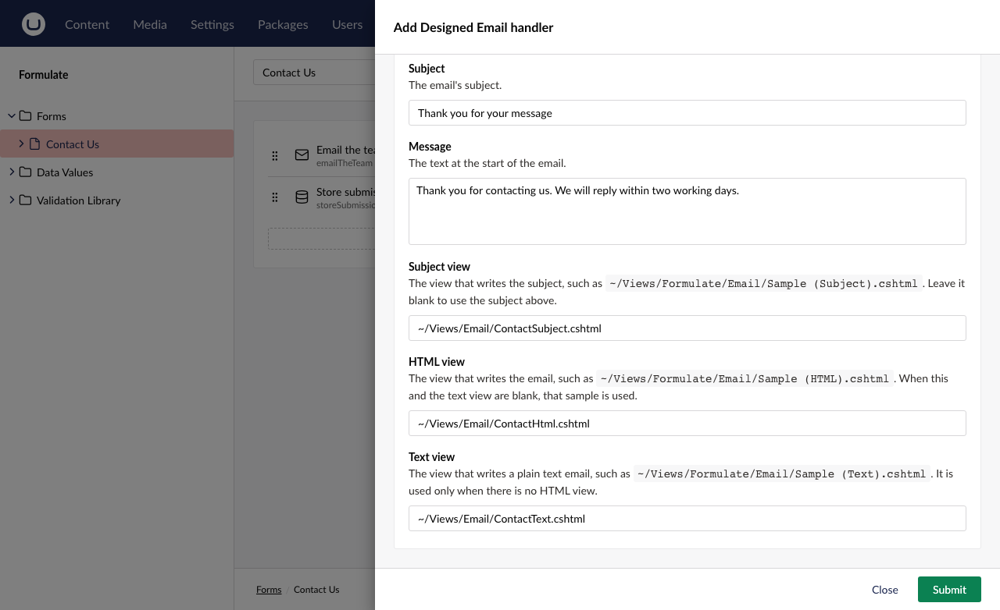
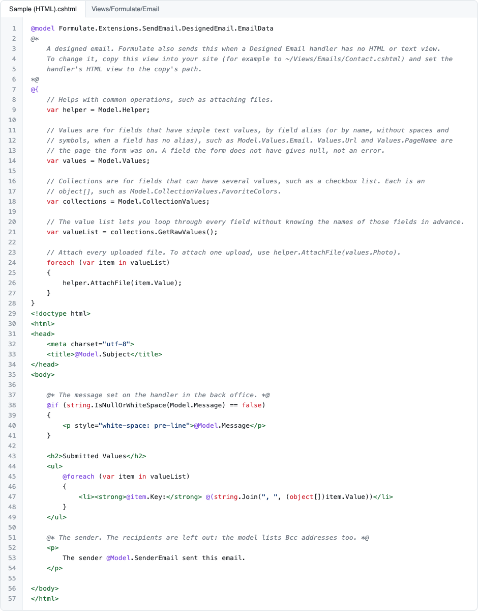

# Designed Emails

Designed Emails used to be part of Formulate Pro. Formulate Pro is now part of Formulate, so this feature is in the main package, for free.

The "Designed Email" form handler sends an email that you design with Razor views. You write three views:

* The subject.
* The HTML body.
* The text body.

An email has one body, because Umbraco's email sender sends one. It is the HTML body when there is an HTML view, and the text body only when there is not.

When somebody submits a contact form, they get an email that looks the way you want. The Email handler sends a plain list of field labels and values instead.



# How to Set Up a Designed Email

1. Write the Razor views for the subject, HTML body and text body. Or start from the samples that come with Formulate (see below).
2. Open your form in the Formulate section of the back office.
3. Add a handler and choose "Designed Email".
4. Enter the paths to your views.
5. Make sure [SMTP is configured](/smtp-configuration).



# Where the Views Live

The views are Razor views in your site. The handler saves their paths in these settings, and you enter them in the handler's settings in the back office:

| Setting | What the view writes |
| --- | --- |
| `subjectRazorPath` | The subject. When blank, the subject set on the handler is used. |
| `htmlEmailRazorPath` | The HTML body. |
| `textEmailRazorPath` | The plain text body. It is used when there is no HTML view. |

Each email has one body, because Umbraco's email sender sends one. Designed Email sends its HTML view or, when there is none, its text view.

Sample views ship in the package at these paths:

* `~/Views/Formulate/Email/Sample (HTML).cshtml`
* `~/Views/Formulate/Email/Sample (Text).cshtml`
* `~/Views/Formulate/Email/Sample (Subject).cshtml`

When a handler has neither an HTML nor a text view, the HTML sample is used. To change a sample, copy it into your site (for example to `~/Views/Emails/Contact.cshtml`) and set the handler's path to the copy. A view of your own at a sample's path replaces the sample.

# The Model

Every view has this model:

```cshtml
@model Formulate.Extensions.SendEmail.DesignedEmail.EmailData
```

`EmailData` holds:

* `Values`: the first value of each field, by field alias (or by name, when a field has no alias), such as `Model.Values.FirstName`. `Values.Url` and `Values.PageName` are the page the form was on. A value that is missing is `null`. An upload's value is an `EmailDataFile`, with `FileName`, `FileData` and `ContentType`.
* `CollectionValues`: every value of each field, as an `object[]`, such as `Model.CollectionValues.FavoriteColors`. A missing value is an empty array. `GetRawValues()` lists them all, so you can loop through the fields without knowing their names.
* `SenderEmail` and `RecipientEmails`: the sender, and the recipients in alphabetical order.
* `Subject` and `Message`: the subject and the message set on the handler.
* `Helper`: helps with common jobs. `Model.Helper.AttachFile(Model.Values.Photo)` attaches an uploaded file.

Designed Email views get the posted values unchanged. Of the email handlers, only the plain Email handler formats dates. So a Date field is `yyyy-MM-dd` in a Designed Email view.

The views in a Formulate 3 site were written for MVC 5, so update them to ASP.NET Core Razor. See the [extending docs on GitHub](https://github.com/Nicholas-Westby/formulate/blob/v5/main/docs/extending.md) for more.

# Formulate 3

In Formulate 3, Designed Emails came with the separate Formulate Pro package. The views inherited from `TemplateBase<EmailData>`. That version is documented in the [Formulate Pro source](https://github.com/Formulate-Pro/Formulate-Pro).
