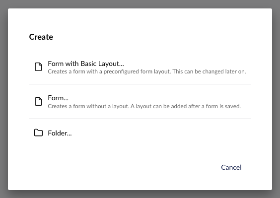
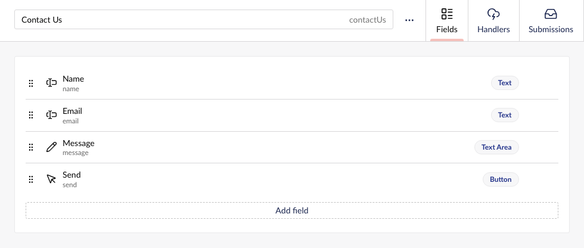
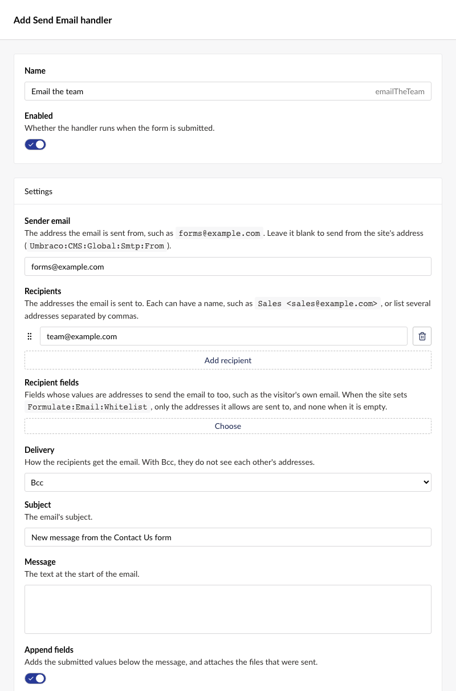
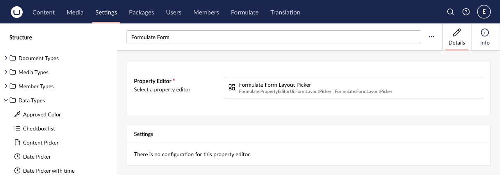
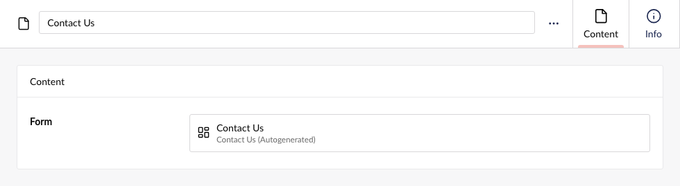
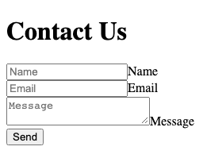

# Creating a Simple Form

This tutorial makes a Contact Us form and shows it on a page. The steps are:

* Create a form, with fields and a button.
* Add a handler.
* Get a layout.
* Add the form picker to a document type.
* Pick the layout on a page.
* Render the form.
* Style the form.

Here are those steps, explained in detail.

# Create a Form

1. Open the Formulate section. Under Forms, open the menu of the Forms root and choose Create.
2. The dialog offers Form with Basic Layout, Form and Folder. Choose Form with Basic Layout. When you save the form, Formulate also makes a layout for it (more on that below). Name the form "Contact Us".

# Add Fields

1. On the Fields tab, choose Add field.
2. Pick a kind and fill in the dialog (name, alias, label, validations and the kind's own settings), then choose Submit to close it.
3. Add these fields: Name (Text), Email (Text) and Message (Text Area).
4. Add a Button field named Send. Set its Button kind to Submit, which sends the form. Every form needs at least one button.
5. Drag the fields into the order you want, then choose Save. Nothing is stored until you save.

# Add a Handler

A handler runs when the form is submitted. To get an email for each submission:

1. Open the Handlers tab and choose Add handler.
2. Pick the Send Email handler. Set its Sender email, Recipients and Subject. Turn on Append fields to include what the visitor typed in the email.
3. Choose Save.

Email is sent through Umbraco's email settings, so set up SMTP in `appsettings.json` first. See [Configuring SMTP for Emails](/smtp-configuration).

# Get a Layout

A layout says how the fields are arranged and which template shows them. There are two ways to get one:

* A form made with Form with Basic Layout already has one. It is under the form in the tree, named after the form with "(Autogenerated)". It shows every field, one under another, and its Template is Plain JavaScript.
* For a form made with Form, open the form's menu in the tree and choose Create to make a layout, then choose its Template.

Either way, you can open the layout later to arrange the fields yourself. See [Creating a Complex Form](/complex-form).

# Add the Form Picker to a Document Type

1. Open the Settings section and create a data type. Choose the property editor Formulate Form Layout Picker.
2. Open the document type for your page and add a property that uses that data type. Give it an alias such as `form`.
3. Save the document type.

# Pick the Layout on a Page

1. Open the page in the Content section.
2. On the form property, choose Choose.
3. Pick the layout. Expand the Contact Us form in the dialog to see its layouts.
4. Save and publish the page.

The property stores the layout, so a page can use any of a form's layouts. Remove clears the pick.

# Render the Form

Show the picked form in the Razor view for your page. See [Render Form](/plain-javascript/render-form) for how.

# Style the Form

Forms have no styles by default. To style the form, turn on the [Basic theme](/pro/basic-theme), or write your own CSS to match your site.
