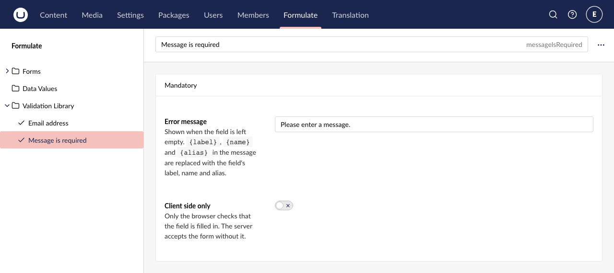
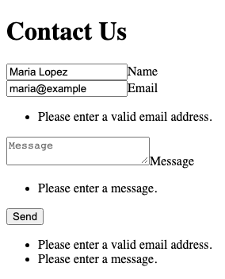

# Validations

Validations make sure visitors enter correct values. A validation has a message, which the form shows with the field when the check fails. You make validations once, in the Validation Library, and pick them on as many fields as you like.

# The Validations That Ship

Formulate has two kinds of validation:

* **Mandatory.** The field must be filled in.
* **Regular Expression.** The value must match a pattern.

You can add more kinds in C#. See [Extending Formulate](https://github.com/Nicholas-Westby/formulate/blob/v5/main/docs/extending.md).

# Create a Validation

1. Open the Formulate section. Under Validation Library, open the menu of the root and choose Create.
2. Pick the kind, Mandatory or Regular Expression, and name the validation.
3. Fill in its settings (below) and choose Save.

## Mandatory

* **Error message.** Shown when the field is left empty. For example, "Please enter a message."
* **Client side only.** When it is on, only the browser checks that the field is filled in, and the server accepts the form without it. Leave it off to have the server check too.

## Regular Expression

* **Regular expression.** The pattern a value must match, such as `^\d{5}$` for a five digit zip code. Formulate warns you when browsers cannot read the pattern.
* **Error message.** Shown when the value does not match the pattern. For example, "Please enter a valid email address."

The server also checks Regular Expression validations when a form is submitted. You can turn that off with the setting `Formulate:Submissions:EnableServerSideValidation`.

# Placeholders in Messages

The message of a Mandatory or Regular Expression validation can use the field's own values. Formulate replaces these placeholders, in any letter case, both in the browser and in the errors the server sends back:

* **{name}** is the field's name.
* **{alias}** is the field's alias.
* **{label}** is the field's label, or its name when it has no label.
* **{{}** gives a `{`, in case your message needs a curly brace.

For example, a Mandatory validation with the message "{label} is required." shows "Message is required." on a field labelled Message, so one validation can serve many fields. Anything else in braces is left as you wrote it.

# Pick Validations on a Field

1. Open the form and its Fields tab, then edit the field (or add one).
2. In the Validations setting, choose Choose and pick one or more validations.
3. Drag them into the order you want. They are checked in that order when the form is submitted.
4. Choose Submit to close the dialog, then Save the form.

# What Visitors See

When a field fails a validation, the form shows that validation's message with the field. Errors from the server come back to the browser and are shown on their fields in the same way.

