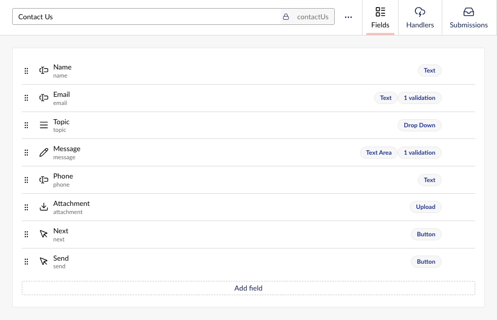

# What is Formulate?

Formulate lets non-technical users design forms in Umbraco. You then show that form (for example, a contact form) on your website. It's a free, open source form builder.

# Features

* Build forms from fields: Text, Text Area, Hidden, Drop Down, Checkbox, Checkbox List, Radio Button List, Extended Radio Button List, Date, Upload, Button, Header, Rich Text, Text Constant and reCAPTCHA.
* Do something with each submission using handlers: Store Data, Email, Designed Email and Send Data.
* Reuse validations (Mandatory and Regular Expression), so you don't have to enter the same email pattern over and over.
* Reuse data values (List, Pair List and US States) for drop downs and similar fields.
* Use folders for forms, data values and validations to keep things organized.
* View stored submissions in the back office and export them to CSV.
* Submit forms with AJAX, so the page doesn't reload.
* Style forms with your own CSS, or turn on the optional basic theme.
* Extend it. Everything has an alias, so developers can add their own fields, handlers and validations.

See [What's New in Formulate 5](/whats-new-in-5) for the latest release.
