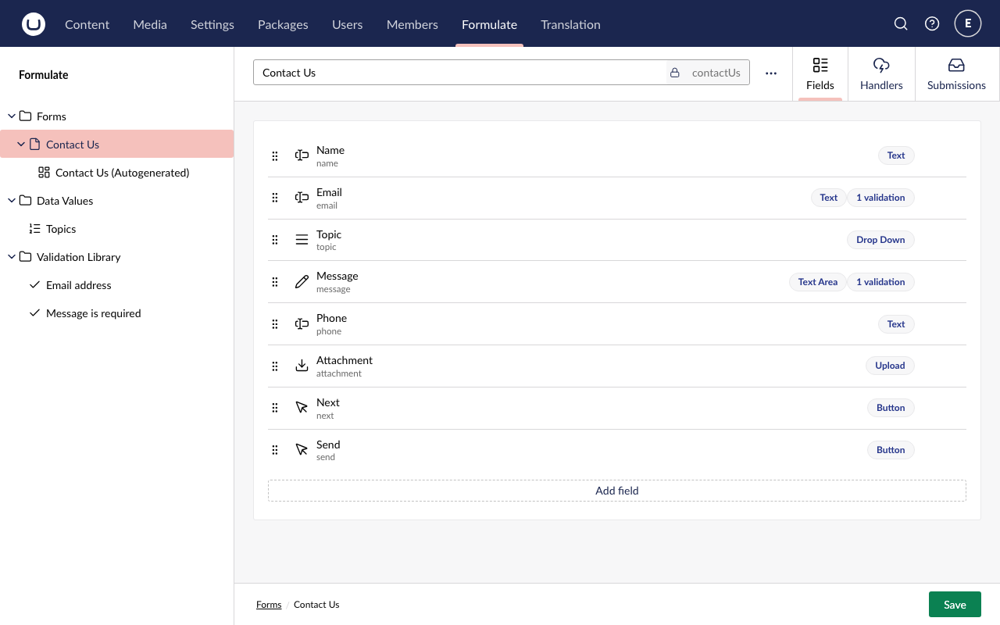
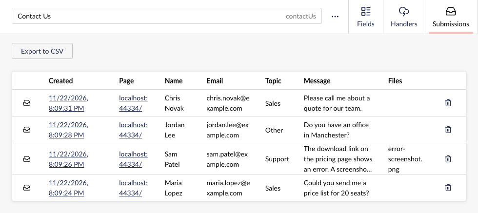

# What's New in Formulate 5

Formulate 5.0.0 is a new version for current Umbraco. Formulate 4 was never released.

# What Changed

* **New back office.** It is built for Umbraco's new back office and uses Umbraco's own UI components, so it looks like the rest of Umbraco.
* **A Formulate section with three trees.** Forms (each form has its layouts under it), Data Values and Validation Library. You can create folders, and move, delete and duplicate items.
* **Submissions view.** Forms with a Store Data handler show their submissions, with CSV export.
* **Formulate Pro is now part of Formulate, for free.** [Designed Emails](/pro/designed-emails) and the [basic theme](/pro/basic-theme) are in the main package. Pro licences are no longer needed or sold.
* **No telemetry.** Formulate 5 doesn't send any usage data anywhere.

# Requirements

Formulate 5 needs Umbraco 17.6 or later 17.x (17 is the LTS release), Umbraco 18 or the Umbraco 19 release candidate. That is .NET 10 for Umbraco 17 and 18, and .NET 11 for Umbraco 19. See [Requirements](/requirements).

Install it with `dotnet add package Umbraco.Community.Formulate`. See [Installing](/installing).

# Render a Form in Five Steps

1. Create a data type using the "Formulate Form Layout Picker" property editor.
2. Add a property that uses it (for example, alias `form`) to a document type.
3. Pick a form layout on the content node.
4. Render it in your Razor template: `@await Component.InvokeAsync("FormulateForm", Model.Value<Formulate.Core.FormLayout>("form"))`. With Models Builder, use `@await Component.InvokeAsync("FormulateForm", Model.Form)`.
5. The form renderer script is added to the page automatically. To add it yourself, set `"Formulate": { "PlainJavaScript": { "IncludeScript": false } }` in `appsettings.json`.

More detail is on the [Render Form](/plain-javascript/render-form) page.

# Upgrading from Formulate 3

There is no automatic migration. The full steps, the settings that moved and the list of what is not carried over are in the [upgrade guide on GitHub](https://github.com/Nicholas-Westby/formulate/blob/v5/main/docs/upgrading-from-v3.md). The main points are:

* **New package ID.** Install `Umbraco.Community.Formulate`. The old `Formulate` package is Formulate 3 for Umbraco 8 and won't get updates. Formulate 5 has no Umbraco 8 to 17 upgrade path of its own, so get the site onto Umbraco 17.6 or later first.
* **Copy your data.** Copy Formulate 3's `App_Data/Formulate/Json` folder into the new site. Formulate 5 loads its forms, validations, data values and folders, and keeps their ids and kind ids.
* **Layouts don't come across.** Formulate 5 takes a layout's form from its place under the form, and keeps the template on the layout. Formulate 3's layouts and configured forms (`ConfiguredForms/*.conform`, which held the template choice) are never read. Add a layout to each form. The upgrade guide has an optional way to move layouts by hand.
* **Re-create the form picker.** The new property editor, `Formulate.FormLayoutPicker`, stores a layout id, and the old one stored a configured form id. Create a data type with the new editor, then pick the form again on every page.
* **"List Function" data values** load as a legacy kind with no items. Re-create them as a List or US States data value.
* **Send Data's JSON format** sends a plain object by default. To keep Formulate 3's `[ {...} ]`, set `Formulate:SendData:JsonMode` to `WrappedArray`. Date values are sent as `MMMM dd, yyyy`.
* **Settings** are in `appsettings.json` now. See the [settings table](https://github.com/Nicholas-Westby/formulate/blob/v5/main/README.md#settings).
* **The front end stays the same.** The BEM classes (`formulate__...`), JavaScript events and custom field type hooks (`window["formulate-plain-js-fields"]`) are unchanged. Existing styles and custom field types keep working.
* **No AngularJS template.** The AngularJS pages on this site apply to Formulate 3 only.
* **Questions go to GitHub.** Please use the [issue tracker](https://github.com/Nicholas-Westby/formulate/issues).
